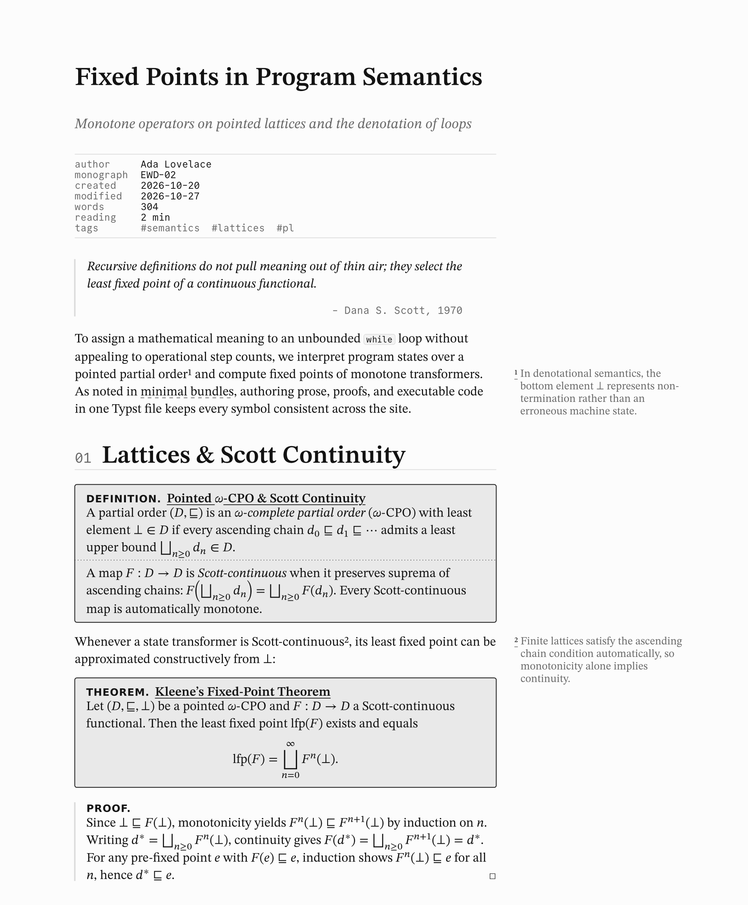

# typica

Monochrome HTML blog bundles for computer science and mathematics in pure [Typst](https://typst.app) (`>= 0.15.1`), with native browser MathML, right-margin sidenotes, mathematical environments, syntax-highlighted code listings, and Atom 1.0 + RSS 2.0 feeds.

- **Reference Manual:** [`docs/manual.pdf`](docs/manual.pdf) (complete function signatures, parameter tables, and theming reference)
- **Examples:** [`examples/minimal`](examples/minimal) · [`examples/custom-theme`](examples/custom-theme) · [`examples/co-located-assets`](examples/co-located-assets)
- **Repository:** [`github.com/bfeitknecht/typica`](https://github.com/bfeitknecht/typica)

<p align="center">
  <picture>
    <source media="(prefers-color-scheme: dark)" srcset="assets/preview-dark.png">
    <source media="(prefers-color-scheme: light)" srcset="assets/preview-light.png">
    
  </picture>
</p>

Every page in the generated site bundle is pure semantic HTML5 with native MathML, set by default in the unified _STIX Two_ family (_STIX Two Text_ for prose & sidenotes + _STIX Two Math_ for equations), _Helvetica Neue_ (environment & proof headings), and _Commit Mono_ (code & metadata) — all configurable from a single `theme` dictionary across both HTML and paged previews. It includes automatic OS dark/light mode (`color-scheme: dark light` + `light-dark(...)`), right-margin sidenotes (`<= 1100px` numbered CSS pop-ups), Atom 1.0 + RSS 2.0 syndication (`@preview/exemel`), and a two-column `@media print` stylesheet (`Ctrl+P` produces an archival print layout without shipping duplicate PDFs).

## Quick Start

```sh
typst init @preview/typica:0.1.0 my-blog
cd my-blog
```

- **Build the complete static site (`index.html`, `404.html`, `posts/<slug>/index.html`, co-located post assets, `css/style.css`, `rss.xml`, `atom.xml`):**
    ```sh
    typst compile --features html,bundle --format bundle site.typ public
    ```
- **Live-preview any post or the site while writing:**
    ```sh
    typst watch posts/fixed-points.typ
    ```
- **Compile a standalone single-file HTML post (with inlined CSS):**
    ```sh
    typst compile --features html --format html posts/fixed-points.typ
    ```

## Authoring Workflow

### 1. Write standalone posts (`posts/<slug>.typ`, or `posts/<slug>/index.typ` when co-locating assets)

Posts without external files live directly as flat `.typ` files (`posts/<slug>.typ`). When a post carries co-located images, SVGs, or downloads, place it in its own directory (`posts/<slug>/index.typ`):

```typst
#import "@preview/typica:0.1.0": *

#show: post.with(
  title: [Fixed Points in Program Semantics],
  subtitle: [Monotone operators on pointed lattices and the denotation of loops],
  author: "Ada Lovelace",
  monograph: "EWD-02", // Optional monograph identifier rendered beneath `author`
  created: datetime(year: 2026, month: 10, day: 20),
  modified: datetime(year: 2026, month: 10, day: 27),
  summary: [Constructing loop semantics via Kleene iteration and monotone transformers.],
  tags: ("semantics", "lattices", "pl"),
  // Optional co-located files emitted into `posts/<slug>/` (when using `posts/<slug>/index.typ`):
  // assets: ("dfa.svg": read("dfa.svg", encoding: none)),
)

= Lattices & Scott Continuity <kleene-fp>

See @minimal-bundles for details on HTML bundles, or return to @site[`folio`].
```

When using a directory post (`posts/<slug>/index.typ`), `#image("dfa.svg")` resolves relative to that directory in paged previews while `assets: (...)` (or inline `#post-asset("dfa.svg", read("dfa.svg", encoding: none)) <dfa>`) emits the file into `posts/<slug>/dfa.svg` in the HTML bundle. See [`examples/co-located-assets`](examples/co-located-assets) for a runnable setup.

### 2. Mount posts & write your homepage (`site.typ`)

Write your homepage directly in `site.typ` and place `#post(include "posts/...") <slug>` right where each post entry should appear. `site(title: auto, ...)` automatically infers the site title from the first `= ...` heading in `site.typ` (or accepts explicit strings, raw `` `something` ``, or math `$sin(x)$` — rendering `<h1>` automatically if `site.typ` omits a top-level heading). Attaching `<slug>` renders the homepage entry card in place, emits `posts/<slug>/index.html` (plus any co-located post assets), populates `rss.xml` and `atom.xml`, and lets any post cross-reference it with `@slug`:

```typst
#import "@preview/typica:0.1.0": *

#show: site.with(
  description: "Notes on programming languages, formal methods, and systems.",
  url: "https://blog.example.org",
  author: "Ada Lovelace",
)

= `folio`

Notes on programming languages, formal methods, mathematics, and systems.

#links-row(
  link("https://example.org")[example.org],
  link("https://github.com/example")[github],
  [@rss[rss]],
  [@atom[atom]],
)

== Posts

#post(include "posts/fixed-points.typ") <fixed-points>
#post(include "posts/minimal-bundles.typ") <minimal-bundles>
```

Built-in bundle labels:

- `@site` — links to `index.html` from any post
- `@<slug>` — links to `posts/<slug>/index.html` from any post or the homepage
- `@<heading-label>` — links across posts directly to `posts/<slug>/index.html#<heading-label>`
- `@rss` / `@atom` — links to `rss.xml` and `atom.xml` (`<link rel="alternate">` discovery tags are emitted only on the homepage)

## Exported Library Overview

Full parameter tables and rendered examples are in [`docs/manual.pdf`](docs/manual.pdf).

| Category            | Exported Symbols                                                                                                           |
| :------------------ | :------------------------------------------------------------------------------------------------------------------------- |
| **Site & Posts**    | `site`, `post`, `post-list`, `post-asset`, `query-all-posts`                                                               |
| **Math & Boxes**    | `definition`, `theorem`, `example`, `recipe`, `sbox`, `proof`                                                              |
| **Margin Notes**    | `sidenote`, `note`, `sidenote-counter`, `reset-sidenotes` (plus automatic `#footnote[...]` routing)                        |
| **Tables & Code**   | `grid-table`, `tablem`, `zebraw`, `zebraw-init`, `codeblock`, `checklist`                                                  |
| **Layout & Chrome** | `wide`, `diagram`, `epigraph`, `kbd`, `links-row`                                                                          |
| **Theme & CSS**     | `default-theme`, `resolve-theme`, `active-theme`, `build-stylesheet`, `css-oklch`, `stylesheet-href`                       |
| **Refs & Feeds**    | `with-smart-refs`, `resolve-bundle-label`, `slugify`, `post-html-path`, `format-date`, `build-rss-feed`, `build-atom-feed` |

## Customizing Fonts & Palette (`theme`)

Pass `theme: (...)` to `site.with(...)` (or per-post `post.with(...)`) to override any font stack or `oklch` color token across **both** the generated HTML stylesheet and paged Typst previews (see [`examples/custom-theme`](examples/custom-theme)):

```typst
#show: site.with(
  title: "folio",
  theme: (
    serif-fonts: ("STIX Two Text", "Libertinus Serif"),
    math-fonts: ("STIX Two Math",),
    sans-fonts: ("Helvetica Neue", "Helvetica", "Arial"),
    mono-fonts: ("Commit Mono", "CommitMono", "DejaVu Sans Mono"),
    // `auto` emits built-in @font-face rules only for default families still in use;
    // pass custom `@font-face` CSS (or `none`) when switching web fonts.
    font-faces: auto,
  ),
)
```

## Releasing to Typst Universe (Automated Draft PRs)

Pushing a version tag (`just release v0.1.0 "initial release"`) runs [`.github/workflows/release.yaml`](.github/workflows/release.yaml), which verifies the build, publishes the GitHub Release (with `docs/manual.pdf`), lints the staged package with official [`typst-package-check`](https://github.com/typst/package-check), pushes branch `typica-<version>` to your `typst/packages` fork, and opens a **Draft PR** against [`typst/packages`](https://github.com/typst/packages).

### One-Time GitHub Setup

1. Fork [`github.com/typst/packages`](https://github.com/typst/packages) to `bfeitknecht/packages` (or set repository variable `UNIVERSE_FORK` if named differently).
2. Create a classic Personal Access Token (`public_repo` scope, required by GitHub's API to open cross-repo PRs against `typst/packages`) and save it on `bfeitknecht/typica` as Actions repository secret **`UNIVERSE_TOKEN`**.

### Remaining Checklist for `v0.1.0`

1. Wait for upstream [`wensimehrp/exemel`](https://github.com/wensimehrp/exemel) to merge RSS 2.0 support and publish `@preview/exemel:0.2.0` on Typst Universe.
2. Remove `vendor/` (`git rm -r vendor`) and the `TODO` comment in `src/feeds.typ` (`release.yaml` intentionally refuses to open a Universe PR while `vendor/` is non-empty).
3. Run:
    ```sh
    just release v0.1.0 "initial release"
    ```
4. Review the opened Draft PR on `github.com/typst/packages` and click **Ready for review**.

## License

Dual-licensed under **`MIT AND MIT-0`** (see [`LICENSE`](LICENSE)):

- **Library & documentation (`src/`, `docs/`, `assets/`):** [MIT License](LICENSE)
- **Starter template & examples (`template/`, `examples/`):** [MIT No Attribution (`MIT-0`)](LICENSE) — projects created with `typst init @preview/typica:0.1.0` may be modified and published without attribution or license-redistribution requirements.
